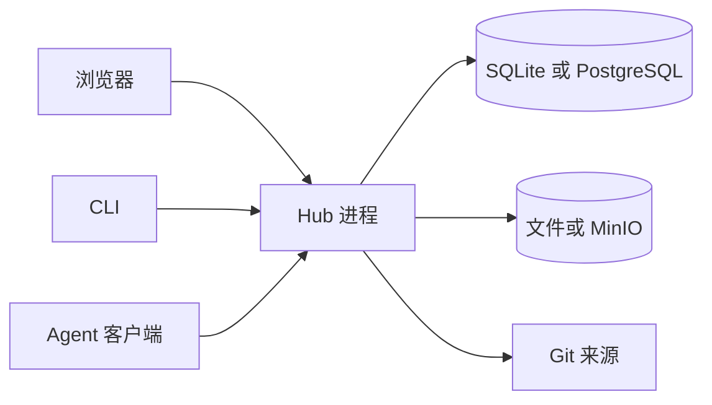

# Capability Hub

自托管平台，用来登记、扫描、独立审核并分发 Agent Skill 与 MCP 描述。内容来自 Skill ZIP、MCP 描述，或已登记 Git 目标的同步。扫描通过不会自动发布；审核通过后按固定版本交付，之后每次读取都按当前受众决定是否可见。

- Web：公开发现、阅读和下载；登录后管理来源、提交发布、审核及账号权限。
- HTTP / Hub MCP：检索可见资源、读取固定内容、交付安装材料，以及生成客户端配置。
- CLI：浏览器批准登录，搜索、校验后安装 Skill，或输出 MCP 配置。

Hub 不执行上传的脚本，也不代替客户端连接目标 MCP 服务。

## 快速开始

需要 Node.js **24.22.1**、pnpm **10.33.0**。登记 Git 来源或使用 SSH 凭据时还需要 Git 和 OpenSSH。

```sh
nvm use
pnpm install --frozen-lockfile
cp .env.example .env
pnpm dev
```

服务监听 `127.0.0.1:4100`。默认 SQLite 在 `.data/hub.sqlite`，内容在 `.data/blobs`；未设置实例密钥时生成私有 `instance.key`。数据与密钥不入库，路径相对仓库解析。

另开终端。Vite 把 API、认证、公开资源和 MCP 转到 `4100`：

```sh
pnpm dev:web
```

打开 `http://127.0.0.1:5173`，创建首个管理员和初始维护团队。

## 安装与接入

配置部署方提供的 npm 仓库后，执行 `npm install -g @capability-hub/cli`。源码运行用 `pnpm cli`。`login` 显示批准链接和授权码，由浏览器确认；网页登录与终端凭据分开保存。

```sh
capability-hub login --url http://127.0.0.1:4100
capability-hub search TypeScript
capability-hub add NAME --version VERSION --to .agents/skills --dry-run
```

`add` 只写入 `--to`，安装目录见[Agent 客户端接入](documents/reference/agent-clients.md)。先看 dry-run 差异，再去掉该参数安装；目录已存在时需 `--replace`，旧内容保留在输出的备份目录。发布和审核见[资源使用与发布](documents/getting-started/workflows.md)。

页面「连接你的 Agent」生成接入说明。CLI 的 `hub-config` 离线生成配置且不写文件，`connect` 在浏览器批准后写入客户端配置。支持的客户端、配置位置和验收边界见[Agent 客户端接入](documents/reference/agent-clients.md)。HTTP、Hub MCP 与 CLI 参数见 [HTTP、MCP 与 CLI](documents/reference/interfaces.md)。

## 运行形态

默认由一个 Node 进程提供 JSON API、`/mcp` 和后台作业，生产入口同时托管已构建的页面。开发时页面由 Vite 另开。没有独立队列或微服务，也不动态加载第三方插件。



包之间的依赖和调用见[系统架构](documents/architecture/system.md)。

## 常用命令

在仓库根目录执行。

| 命令                 | 作用                                                           |
| -------------------- | -------------------------------------------------------------- |
| `pnpm check`         | 架构、文档链接、迁移校验、lint、格式、类型检查、构建和默认测试 |
| `pnpm test`          | unit、integration、components                                  |
| `pnpm test:external` | 本机 Docker 上的 PostgreSQL、MinIO、SSH Git 和 OpenLDAP        |
| `pnpm build`         | 类型检查，并编译各包、Web 和运维脚本                           |
| `pnpm start`         | 用编译产物提供页面、API 和 MCP                                 |
| `pnpm cli`           | 源码 CLI；终端中省略子命令打开菜单，`-h` 查看帮助              |

`pnpm check` 不包含 `test:external`。本机运行见[本地开发](documents/getting-started/local-development.md)，测试分组见[测试策略](documents/development/testing.md)。

## 仓库

| 路径                      | 职责                              |
| ------------------------- | --------------------------------- |
| `apps/server`             | HTTP、MCP、装配和持久任务         |
| `apps/web`                | React 页面                        |
| `apps/cli`                | 消费者命令行                      |
| `packages/contracts`      | 请求校验、响应类型和共享协议      |
| `packages/domain`         | 业务模型、权限和规范化            |
| `packages/application`    | 用例与外部能力端口                |
| `packages/ai`             | Mastra 运行时、隔离和模型治理     |
| `packages/hub-agents`     | 业务 Agent 的操作定义             |
| `packages/infrastructure` | 数据库、对象存储、Git、扫描和安全 |
| `packages/logging`        | 服务端与浏览器日志                |

模块边界见[模块职责](documents/architecture/modules.md)。改代码前读 [AGENTS.md](AGENTS.md)。

## 配置与部署

开发服务只绑定 loopback。生产必须设置 `NODE_ENV=production`、对外 HTTP(S) 根地址、64 位十六进制 `CAPABILITY_HUB_INSTANCE_SECRET`，以及首次初始化用的 `CAPABILITY_HUB_SETUP_TOKEN`。未配置模型时不能发起 AI 任务。

变量见[配置参考](documents/reference/configuration.md)。镜像、Compose 和健康检查见[容器部署](documents/operations/deployment.md)。备份与恢复见[备份、恢复与维护](documents/operations/recovery.md)。

服务启动时应用当前迁移历史里尚未执行的变更。不会转换这套迁移之外的旧数据库，也不会自动切换数据库后端。变更流程见[数据库结构与迁移](documents/development/database-migrations.md)。

其余说明集中在[工程文档](documents/README.md)。
