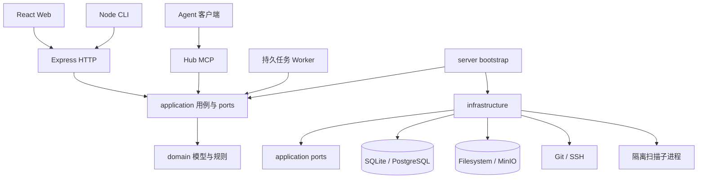

# 系统架构

## 范围

Capability Hub 是模块化单体。HTTP 与 MCP 复用应用用例；Worker 在同一服务进程执行持久化作业。Web 和 CLI 为独立入口。当前没有独立队列服务、微服务或预建插件框架。

箭头表示调用或依赖。端口定义归应用层，具体实现由装配入口注入；应用层不导入 Express、Drizzle 或基础设施。

## 包边界

| 包             | 所有权                                                               | workspace 依赖                 |
| -------------- | -------------------------------------------------------------------- | ------------------------------ |
| contracts      | 输入校验、响应类型、公共资源地址、工具展示语义、MCP 官方 JSON Schema | 无                             |
| domain         | 业务记录、RBAC、内容规范化、路径规则、版本优先级、审计定义           | 无                             |
| application    | 身份、来源、目录、接收、发布、任务等用例及外部能力端口               | domain                         |
| infrastructure | Drizzle、数据库连接与事务、内容存储、Git、密码/凭据、扫描            | application、domain、contracts |
| logging        | Pino 服务端上下文、浏览器事件批次和脱敏                              | 无                             |

contracts 的 Response 不复用数据库 Record。内部密码哈希、会话秘密、凭据密文和 blob_ref 不随记录新增字段进入响应；浏览器 CSRF 令牌只在已认证的会话响应中显式提供。

## 运行和构建

Node 包使用 NodeNext，Web 使用 Bundler。开发与源码测试显式启用 `development` 导出条件，解析 src；生产默认导出解析 dist，声明文件对应同一产物。pnpm 按依赖顺序编译，并同步注入的 workspace 依赖。

SQL 初始化文件复制到 infrastructure/dist 的对应方言目录。扫描器依模块扩展名启动源码或编译后的子进程。生产不依赖 tsx；容器包含服务、公共包 dist、SQL、官方 Schema 和 Web 产物，运维脚本也预先编译。

## 数据与一致性

元数据由 RecordStore 保存；内容以 SHA-256 寻址。扫描和远程 Git 操作在写事务外执行，提交前重读当前权限、来源配置、资产修订和作业租约。审核通过时发布记录与当前指针原子提交。

读取历史内容同时满足当前发布和该版本最新发布的受众。公开地址始终按匿名受众校验。封禁、撤销、受众收窄在后续请求立即生效。

SQLite 与 PostgreSQL 各维护一条完整的 Drizzle 初始迁移，后续结构变更由 Kit 生成并按迁移历史执行。启动时在互斥事务中应用待执行迁移并校验摘要，不转换未纳入当前迁移体系的旧数据库，也不自动切换后端。
