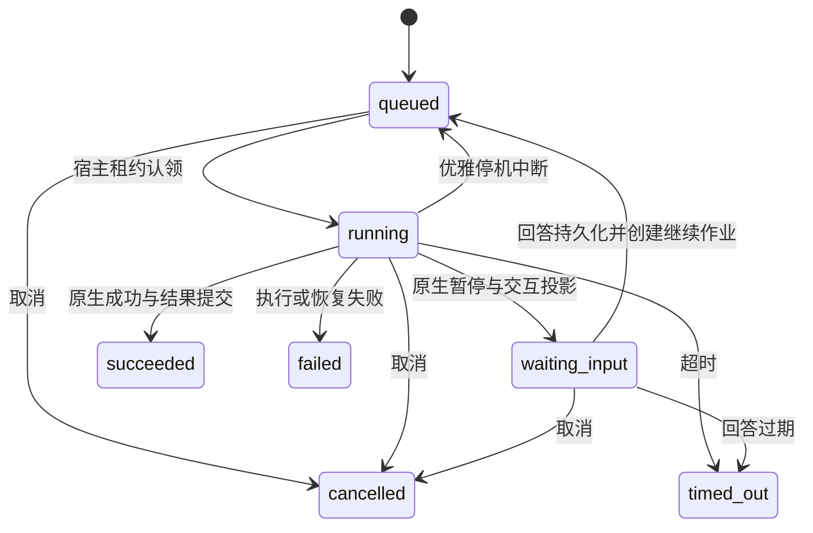

# AI 框架

本文描述已实现的框架、宿主适配与 AI 工作台。反馈研判、资源审计尚未注册为业务操作。

## 分层与扩展

`packages/ai` 是独立的 Node/TypeScript 包，基于锁定版本的 Mastra Core 与 Memory。它不导入 Hub 业务包，不启动 HTTP 服务、Worker 或数据库连接。原生 Agent、Tool、Workflow、Memory 和 Scorer 负责模型循环、工具执行、串并行编排、暂停与恢复；框架补充宿主授权、持久化隔离、预算与事件投影。

`packages/hub-agents` 定义具体操作；`infrastructure/ai` 实现存储、队列和维护适配；`server/bootstrap/ai-services.ts` 统一装配。Application 仍只依赖 Domain，不引入 Mastra。浏览器只依赖 Contracts 中的 DTO，不接收原生 SDK 快照。

| 扩展入口                                                                   | 职责                                                                  |
| -------------------------------------------------------------------------- | --------------------------------------------------------------------- |
| `OperationRegistry.register`                                               | 声明操作 ID、版本、输入/输出 Schema、人工回答 Schema 与 Workflow 工厂 |
| `OperationContext.agent` / `structured`                                    | 原生 Agent 流、工具循环、可选执行内记忆、结构化输出校验               |
| `tool`                                                                     | 参数和结果校验、当前授权、执行预算、取消信号、工具生命周期事件        |
| `step`                                                                     | 步骤事件、当前授权、耗时 trace                                        |
| `effect`                                                                   | 与宿主数据库同一事务的本地效果回执                                    |
| `resource` / `retrieve` / `skill`                                          | 固定版本证据、有限词项检索及引用、Skill 文本资料                      |
| `withMcp`                                                                  | 管理员登记的 Streamable HTTP 端点、只读工具白名单                     |
| `artifact` / `evaluate`                                                    | 内容摘要、幂等成果保存、原生 Scorer 评分                              |
| `AiStore`、`AiQueueBridge`                                                 | 共享事务和不可变租约的宿主适配                                        |
| `AiAuthorization`、`CredentialResolver`、`ResourceResolver`、`AiTelemetry` | 当前授权、凭据解析、资源访问与可选外部遥测                            |

Mastra 公共构造函数从 `@capability-hub/ai/mastra` 导出。定义通过 `create(context)` 返回已 commit 的原生 Workflow，工作流 ID 与操作 ID 相同。业务定义应关闭原生自动恢复和重试；框架装配的 Mastra 关闭 `recovery.workflows` 与 `recovery.durableAgents`，仅由宿主认领后驱动恢复。

业务工具必须通过 `context.tool` 构造；`context.agent` 拒绝未经治理的工具实例。工具中的本地写入通过 `context.effect` 调用应用服务，禁止在其中执行网络请求或其他不可回滚效果。第三方写操作需要独立设计幂等与对账协议。

操作版本是代码行为的发布边界。框架摘要包含 ID、版本及输入/输出/交互 Schema，不解析函数源码；修改提示词、步骤或工具语义必须提升操作版本。定义或模型配置摘要变化后，旧执行拒绝恢复，不能把旧回答套用到新工作流。

## 当前操作与 UI

- `assistant`：基础助手，支持文本统计工具、执行内最近消息、可选 Skill 和已登记 MCP 工具。
- `agent-lab`：规划草案 → 表达和风险两个原生步骤并行 → 人工确认 → 保存成果与评分。共使用 planner、editor、reviewer 三个 Agent 角色；拒绝采纳仍是一次成功完成的决策，其结果 `approved=false`。

登录后访问 `/ai`。具有 `ai:execute` 的用户可以发起、查看、取消自己的执行并回答交互；`ai:inspect` 允许读取其他人的已知执行，不授予代答或取消权限。初始化的平台管理员拥有两项权限，其他内置角色不默认获得；角色授权通过现有权限管理维护，不自动回填历史角色。

工作台是框架能力演示入口。新任务通过操作卡片选择基础助手或多 Agent 协作，支持示例填入、模型选择及可选的参考资源和工具。每次任务独立执行，历史以问题摘要标识，支持筛选已加载记录和手动加载更早记录。

`/ai` 复用站点的顶部导航、主内容容器和页脚，内容最大宽度、与 Header 的间距及页脚留白均遵循公共布局。页标题复用 `PageHead`，与其他板块保持英文引导语、主标题和说明文字的三层结构及统一的字号、行距、响应式留白。仅任务工作区限定高度：随视窗调整，最小 480px、最大 960px，任务历史与内容各自滚动；新输出不会撑长页面，页脚按正常文档流展示。新任务正文与底部操作栏共用内容宽度和边距，模型选择复用通用选择组件，与开始按钮保持同高；窄屏改为纵向排列。小屏通过「任务记录」切换列表和内容。内容分为协作过程、成果和运行详情，状态、视图切换及操作入口保持可见。

协作过程按事件顺序呈现任务目标、Agent 输出、工具调用及人工决策。人工确认直接嵌入过程，顶部提示可定位到确认卡片；切换成果或运行详情时保留未提交的填写内容，回答后在原位置展示决策记录。查看他人的执行时只展示等待状态与决策记录，不提供取消或代答入口；框架取消命令也显式接收操作者并重查授权。多 Agent 通过角色概览、图标、语义色调与阶段标识区分，概览说明规划与并行审查的关系。工具卡片展示调用状态、时间和失败代码，不暴露原始参数与结果；取消或调度已切换但缺少结束事件的调用标为中断，不推断成功。

活动快照从已持久化事件中先过滤文本增量、消息结束、用量和执行结果事件，再取最近 1000 条，刷新后仍能查看工具调用；截断时给出提示。消息全文、交互和成果仍由各自投影提供。具体字段和水位约束见 [AI HTTP 与 SSE](../reference/ai-interfaces.md)。协作过程仅在阅读位置接近底部时跟随新输出，向上阅读后停止跟随，可用「回到最新」恢复；不会滚动整个页面。实时文本在客户端按完整字素边界平滑推进，避免截断 emoji 和组合字符；历史输出不重播，减少动态效果偏好、后台视图或生成结束时直接展示完整文本。动画不改变持久化偏移或 SSE 水位。

协作成果将草案、审查意见、采纳结论和补充意见合并为可读视图，不在同一视图重复展示相同成果与最终结果。演示完整性检查仅表示是否存在审查内容，不代表事实准确性或质量评分。原始输入、结果和成果数据放在运行详情的折叠区。人工审批明确选择采纳或暂不采纳后才能提交；确认卡片中的草案和审查副本默认折叠，按需展开，与协作过程共用滚动区域。

流式文本块使用每次 Agent 调用内单调递增的块标识，不能直接使用模型响应的块 ID：工具续轮可能复用同一响应 ID。写入增量前核验块存在、尚未结束且 UTF-16 偏移连续；结束事件核验最终长度，快照与 SSE 重放使用相同块标识。

模型文本复用安全 Markdown 渲染，不挂载原始 HTML 或远程图片。刷新页面可按 URL 中的 execution ID 恢复视图。断开浏览器连接不会取消执行。

## 模型与资源边界

结构化输出通过 Mastra 的 `jsonPromptInjection: 'system'` 显式向模型发送完整 JSON Schema，避免兼容端点的 JSON 模式只约束语法却遗漏字段定义。模型客户端会按 Schema 将无歧义的字符串表示还原为整数、布尔值、JSON 数组或对象，并重新严格校验。仍不匹配、没有生成对象或输出截断时，无工具且不使用记忆的格式化步骤最多再请求一次；使用原调查资料、字段位置及规则，不重跑调查。纠正请求同样受权限、预算、超时和租约约束。两次均未通过时不会保存业务报告或进入人工采纳。已识别的结构化字段校验失败、缺失结果及输出截断映射为 `AI_OUTPUT_INVALID`；错误说明保留原因分类，不透传 SDK 校验详情或原始结果。运行详情在失败节点同时显示错误说明与代码。

只支持两种协议：`openai` 使用 Chat Completions，`anthropic` 使用 Messages；均由官方 AI SDK provider 生成请求。配置地址是 API 前缀，不能包含最终操作路径、用户信息、查询或 fragment。HTTP 需要 `allow_http=true`。凭据仅在发送请求时通过环境变量名解析，不存入配置、快照或 SSE。

实际请求先在数据库预留，再访问模型。每次请求重新检查执行授权，重定向被拒绝。每次执行默认最多 96 次模型请求、200 次工具调用；单请求默认最多输出 4096 token、60 秒超时。默认单次活跃调度最多 10 分钟，总执行期限 24 小时，最多 8 次人工继续。流事件默认最多 10 MB，终止事件保留写入空间。每执行最多 100 个成果，单个最多 1 MB，合计最多 4 MB（包含内部资源证据）。配置字段和边界由 `aiConfigurationSchema` 定义。

预算是请求数、工具数、输出上限、时间及事件字节限制；不是精确计费预算。Token 用量取自 provider 返回值；只有流完整结束且输入、输出用量均已确认才记为已知，崩溃、取消、断流或用量不完整时增加 unknown 计数，已收到的部分计数仅供诊断，不猜测费用。OpenAI 使用最终 usage 帧，Anthropic 的起始输出计数不作为最终用量，累计输出取自 message_delta，分别遵循 [Chat Completions 流协议](https://developers.openai.com/api/reference/resources/chat/subresources/completions/streaming-events) 和 [Messages 流协议](https://platform.claude.com/docs/en/build-with-claude/streaming)。OpenAI `[DONE]` 与 Anthropic `message_stop` 之前断流均为失败。传输失败会中止当前作用域，阻止 SDK 隐式重试增加请求。已终止的失败执行不会自动重新向模型收费；用户需创建新执行。

资源引用为 `version:<版本 ID>/<文件路径>`。宿主检查当前资源可读权限、固定版本摘要、UTF-8 和 128 KB 上限；使用过的证据保存于内部成果。在模型/工具执行、人工继续、结果读取、历史列表与 SSE 推送前重查资源权限。详情快照、SSE 批次及缺口重置与权限检查共用事务，避免检查后读到新提交的受限资源派生内容。失去资源访问权后不能继续读取派生内容。

Skill 仅接收上述格式的 `SKILL.md`，作为不可信参考资料加入提示；不自动安装依赖、运行命令或扩大授权。检索是有引用的有限词项匹配，不声称提供向量库或语义召回。

MCP 仅使用管理员配置的 HTTP(S) 地址，同时要求工具名在 `read_only_tools` 中且服务器声明 `readOnlyHint=true`。目录 Schema 作为成果固定，恢复时变化会被摘要回执拒绝。服务器的只读标记不是沙箱保证，管理员需信任登记的服务。当前不支持 stdio、任意用户地址或写工具。

## 执行、交互与恢复

队列、执行、快照、事件与本地效果使用同一个 `PersistenceSession`，无跨连接伪事务。作业租约包括 dispatch ID、owner、epoch；每次原生存储写入、消息、事件和本地效果都在事务内检查原始租约和当前执行状态。旧执行者不能通过重新读取新 epoch 获得写入资格。

仍只有一个 HubWorker。现有内容任务保留单飞槽，AI 有一个独立槽；同一秒级调度器允许两类任务各运行一个，模型等待不阻塞内容任务。租约每 20 秒续租。停机先停止调度，中止 AI 活跃作用域，将可恢复执行放回队列，等待任务结束后关闭存储。

原生工作流快照采用独立 SDK 版本和序列化协议，保存快照时同步增加 `snapshot_revision`；宿主投影提交后更新 `projected_revision`。两者之差是尚未投影的持久意图。恢复通过 Mastra 公共 API 读取已有 run：不存在/待执行时 start，活跃状态 restart，暂停状态查回答回执后 resume，已成功时仅补宿主结果，不重复模型或本地效果。

一次执行只接受一个明确的活跃暂停路径。交互状态为 `pending → answered → applied`；取消、过期或失败使未完成交互变为 `cancelled`。回答在同一事务中校验操作者、交互修订、期限、原生路径、定义摘要和回答 Schema，写入回答摘要并创建继续作业。恢复先核对路径和请求摘要，再消费持久回执；不依赖进程内 Promise。

`effect` 的唯一键是 execution ID 与开发者提供的业务键，参数摘要必须一致。它仅保证共享数据库事务内的效果和回执一起提交。模型请求和第三方网络调用不具备 exactly-once 保证；恢复可能重新调用未完成的 Agent 步骤。因此首批远程工具限定为只读，不能宣称任意 Agent 中间工具状态都能无损恢复。

## 数据、保留与观测

| 表                       | 内容                                                                 |
| ------------------------ | -------------------------------------------------------------------- |
| ai_executions            | 所有者、定义/模型摘要、状态、修订、期限、调度、输出投影、用量        |
| ai_events                | execution/audience 内递增 seq、事件版本、attempt、continuation、负载 |
| ai_snapshots             | 原生 workflow/run、SDK 版本、定义摘要、快照及投影修订                |
| ai_interactions          | 暂停路径、occurrence、请求摘要、回答 Schema、状态与操作者回执        |
| ai_effects               | 本地效果唯一键、参数摘要、已提交结果                                 |
| ai_threads / ai_messages | Mastra 执行内会话记忆                                                |
| ai_calls                 | 每个实际模型请求的预留、耗时、用量与结算状态                         |
| ai_traces                | 步骤耗时和安全属性；当前为本地平面 trace                             |
| ai_artifacts             | 名称、媒体类型、内容与摘要；资源证据不公开投影                       |

SQLite 与 PostgreSQL 均使用独立 AI 表、约束和索引，通过新增 Drizzle 迁移创建，不修改已有迁移。记忆限制在当前 execution/owner，默认最近 20 条消息；未开放语义记忆和工作记忆。

备份与恢复包含所有 AI 表，保留快照、交互、效果和事件一致性。恢复到另一数据库后，部署方必须提供相同操作版本、模型配置及凭据。`pnpm maintenance` 清理结束超过 30 天的 AI 执行及子记录，有排队或运行作业的记录不清理。快照和成果包含用户内容，遵循数据库备份的访问控制；框架不保存凭据和模型内部推理流。

本地 trace 和请求用量可用于诊断；可选 `AiTelemetry` 仅收到安全属性，其异常不会改变本地执行结果。当前没有 OpenTelemetry exporter 或计费金额计算。

## 验证入口

默认 `pnpm test` 覆盖两类协议、工具循环、结构化输出、实时 SSE/重放/撤权、人工恢复、预算与流截断，以及 SQLite 的真实 SIGKILL 故障窗口。`pnpm test:external` 使用隔离 PostgreSQL 验证同样的强杀恢复、租约隔离和跨数据库备份。确定性协议夹具不能代替供应商联调；真实模型与浏览器验收需单独报告。

HTTP 与 SSE 契约见 [AI 接口](../reference/ai-interfaces.md)，部署配置见 [配置](../reference/configuration.md)。原生 API 行为参考 [Mastra 工作流](https://mastra.ai/docs/workflows/overview) 与 [流式输出](https://mastra.ai/docs/guides/streaming)，实际版本以锁文件为准。

## 首批业务接入

反馈研判与资源审计的触发、证据工具、人工写回及页面规则见 [业务 Agent](business-agents.md)。工具可声明显式的 `display` 投影，仅供持久活动展示；框架限制为 200 字符并去除控制字符，禁止自动透传参数。业务步骤失败时保留当前执行中捕获的安全 AI 错误，未知原生失败继续使用通用错误。
