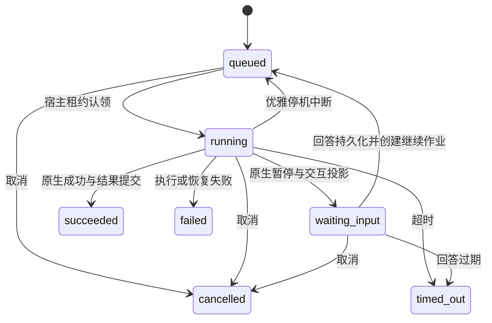

# AI 框架

本文描述已实现的框架、宿主适配和执行边界。反馈研判与资源审计见 [业务 Agent](business-agents.md)。

## 分层与扩展

`packages/ai` 是独立的 Node/TypeScript 包，基于锁定版本的 Mastra Core 与 Memory。它不导入 Hub 业务包，不启动 HTTP 服务、Worker 或数据库连接。原生 Agent、Tool、Workflow、Memory 和 Scorer 负责模型循环、工具执行、串并行编排、暂停与恢复；框架补充宿主授权、持久化隔离、预算与事件投影。

`packages/hub-agents` 定义具体操作；`infrastructure/ai` 实现存储、队列和维护适配；`server/bootstrap/ai-services.ts` 统一装配。Application 仍只依赖 Domain，不引入 Mastra。浏览器只依赖 Contracts 中的 DTO，不接收原生 SDK 快照。

| 扩展入口                                                                   | 职责                                                                  |
| -------------------------------------------------------------------------- | --------------------------------------------------------------------- |
| `OperationRegistry.register`                                               | 声明操作 ID、版本、输入/输出 Schema、人工回答 Schema 与 Workflow 工厂 |
| `OperationContext.agent` / `structured`                                    | 原生 Agent 流、工具循环、可选执行内记忆、结构化输出校验               |
| `tool`                                                                     | 参数和结果校验、当前授权、执行预算、取消信号、工具生命周期事件        |
| `step`                                                                     | 步骤事件、当前授权、耗时 trace                                        |
| `effect`                                                                   | 与宿主数据库同一事务的本地效果回执                                    |
| `resource` / `retrieve` / `skill`                                          | 固定版本证据、有限词项检索及引用、Skill 文本资料                      |
| `withMcp`                                                                  | 管理员登记的 Streamable HTTP 端点、只读工具白名单                     |
| `artifact` / `evaluate`                                                    | 内容摘要、幂等成果保存、原生 Scorer 评分                              |
| `AiStore`、`AiQueueBridge`                                                 | 共享事务和不可变租约的宿主适配                                        |
| `AiAuthorization`、`CredentialResolver`、`ResourceResolver`、`AiTelemetry` | 当前授权、凭据解析、资源访问与可选外部遥测                            |

Mastra 公共构造函数从 `@capability-hub/ai/mastra` 导出。定义通过 `create(context)` 返回已 commit 的原生 Workflow，工作流 ID 与操作 ID 相同。业务定义应关闭原生自动恢复和重试；框架装配的 Mastra 关闭 `recovery.workflows` 与 `recovery.durableAgents`，仅由宿主认领后驱动恢复。

业务工具必须通过 `context.tool` 构造；`context.agent` 拒绝未经治理的工具实例。工具中的本地写入通过 `context.effect` 调用应用服务，禁止在其中执行网络请求或其他不可回滚效果。第三方写操作需要独立设计幂等与对账协议。活动展示只接受调用方显式提供的 `display`，去除控制字符，不自动复制参数或结果；长度见 [AI 接口](../reference/ai-interfaces.md)。

操作版本是代码行为的发布边界。框架摘要包含 ID、版本及输入/输出/交互 Schema，不解析函数源码；修改提示词、步骤或工具语义必须提升操作版本。定义或模型配置摘要变化后，旧执行拒绝恢复，不能把旧回答套用到新工作流。

## 当前操作与权限

账号菜单中的 AI 控制台（`/ai`）要求平台级 `ai:inspect`。配置模型后，任务由 Hub Worker 领取，等待确认时由任务所有者回答并重新入队。

| Agent                      | 自动创建时机及归属                                                                               | 谁能手动发起                                                                                                                  | 结果与人工决定                                                                                                                                 |
| -------------------------- | ------------------------------------------------------------------------------------------------ | ----------------------------------------------------------------------------------------------------------------------------- | ---------------------------------------------------------------------------------------------------------------------------------------------- |
| 基础助手 `assistant`       | 仅手动                                                                                           | 控制台用户还需平台级 `ai:execute` 才能提问。引用 Skill 时须能读取其发布版本                                                   | 直接返回文本，可使用文本统计、执行内记忆和已登记的只读 MCP 工具                                                                                |
| 多 Agent 协作 `agent-lab`  | 仅手动                                                                                           | 控制台用户还需平台级 `ai:execute` 才能提交主题。引用资源时须能读取其发布版本                                                  | `planner` 起草，`editor` 和 `reviewer` 并行检查表达与风险，三者共用同一任务。默认等待所有者确认，`require_approval=false` 时直接保存成果和评分 |
| 资源审计 `resource-audit`  | 上传、Git 同步或重扫的接收记录就绪时归本次接收请求人。提交发布申请、回退申请或通用提名时归提交人 | 须有目标范围的 `ai:execute`，并可按发布受众读取版本、维护该资产或审核该版本对应的申请。也可从「校验与发布申请」或审核详情发起 | 所有者决定是否采纳报告。分类、关键词和共享目的可填入申请草稿，发布仍需独立审核                                                                 |
| 反馈研判 `feedback-triage` | 网页或 MCP 成功上报新反馈时，最多为一名合格维护者创建任务。上报人无需 AI 权限                    | 在目标资产范围有 `ai:execute` 的资产维护者，或持有该权限且仍能读取该版本的反馈上报人。也可从反馈详情发起                      | 所有者决定是否采纳。有维护权限且反馈修订仍匹配时，可选择将反馈置为「处理中」并写入处理说明                                                     |

资源审计和反馈研判中的「整理研判报告」在取证后、人工确认前执行，沿用同一任务的所有者和权限。

**自动任务归属。** 资源审计按所有者和固定版本复用已有任务，失败后可手动重开。反馈研判优先交给反馈所指版本的上传或同步人，前提是账号有效、仍能维护该资产且在其范围有 `ai:execute`。否则按用户名排序，取第一位满足条件的维护者。无模型或无合格所有者时，原业务照常进行。

控制台只列本人的任务。反馈详情另显示自动分派的研判及负责人，缺少分派标识的任务沿用个人任务权限。详情、报告和实时事件均复查当前权限。

| 查看者                             | 能看到什么                                                                                                    | 对 AI 任务的操作                               |
| ---------------------------------- | ------------------------------------------------------------------------------------------------------------- | ---------------------------------------------- |
| 任务所有者                         | 业务任务按目标范围的 `ai:execute` 和资源访问权查看，通用任务须有控制台访问权                                  | 有相应执行权限时，可答复交互或取消未结束的任务 |
| 同一资产的其他维护者               | 在目标资产范围有 `ai:execute`，且仍有版本和反馈访问权时，可从该反馈详情查看自动研判。手动研判沿用个人任务权限 | 只读                                           |
| 其他账号，持有平台级 `ai:inspect`  | 知道执行 ID，且仍能访问任务涉及的版本及反馈时，可看该任务                                                     | 只读                                           |
| 仅有业务查看权的审核者或反馈上报人 | 审核者可看对应发布申请，上报人可看自己仍有权读取的反馈及处理说明                                              | 无                                             |

**角色和范围。** 新实例的平台管理员默认有平台级 `ai:execute` 和 `ai:inspect`。维护者的 `ai:execute` 随角色绑定生效，业务操作按目标资产所属团队、来源或资产匹配范围。审核者和使用者默认没有 AI 权限。审核者获授相应执行权限后，可为自己能审查的版本发起独立审计。既有实例保留已存角色，可按团队补授含 `ai:execute` 的自定义角色。

切换成果或运行详情时保留未提交的确认内容，回答后在原位置保留决策记录。其他人查看待确认交互时看到等待状态，回答后可查看决策记录。协作成果不重复展示与最终结果相同的记录；演示完整性检查只表示是否存在审查内容。人工审批须明确选择后才能提交。取消或调度已切换但缺少结束事件的工具调用标为中断。模型文本不挂载原始 HTML 或远程图片。

写入文本增量前核验块尚未结束且 UTF-16 偏移连续，结束事件核验最终长度。活动快照、事件水位和偏移计数见 [AI 接口](../reference/ai-interfaces.md)。客户端动画不改变已持久化的偏移或水位。

## 模型与资源边界

结构化输出通过 Mastra 的 `jsonPromptInjection: 'system'` 向模型发送完整 JSON Schema。模型客户端按 Schema 将无歧义的字符串还原为整数、布尔值、JSON 数组或对象，并重新严格校验。仍不匹配、没有生成对象或输出截断时，无工具且不使用记忆的格式化步骤最多再请求一次，使用原调查资料、字段位置和规则，不重跑调查。纠正请求受权限、预算、超时和租约约束。两次均未通过时不保存业务报告，也不进入人工采纳。字段校验失败、缺失结果和输出截断映射为 `AI_OUTPUT_INVALID`；错误说明保留原因分类，不透传 SDK 校验详情或原始结果。步骤失败时保留已捕获的安全 AI 错误，未知原生失败使用通用错误。

只支持两种协议：`openai` 使用 Chat Completions，`anthropic` 使用 Messages；均由官方 AI SDK provider 生成请求。配置地址是 API 前缀，不能包含最终操作路径、用户信息、查询或 fragment。HTTP 需要 `allow_http=true`。凭据仅在发送请求时通过环境变量名解析，不存入配置、快照或 SSE。

实际请求先在数据库预留，再访问模型。每次请求重新检查执行授权，重定向被拒绝。每次执行默认最多 96 次模型请求、200 次工具调用；单请求默认最多输出 4096 token、60 秒超时。默认单次活跃调度最多 10 分钟，总执行期限 24 小时，最多 8 次人工继续。流事件默认最多 10 MB，终止事件保留写入空间。每执行最多 100 个成果，单个最多 1 MB，合计最多 4 MB（包含内部资源证据）。配置字段和边界由 `aiConfigurationSchema` 定义。

预算是请求数、工具数、输出上限、时间及事件字节限制；不是精确计费预算。Token 用量取自 provider 返回值；只有流完整结束且输入、输出用量均已确认才记为已知，崩溃、取消、断流或用量不完整时增加 unknown 计数，已收到的部分计数仅供诊断，不猜测费用。OpenAI 使用最终 usage 帧，Anthropic 的起始输出计数不作为最终用量，累计输出取自 message_delta，分别遵循 [Chat Completions 流协议](https://developers.openai.com/api/reference/resources/chat/subresources/completions/streaming-events) 和 [Messages 流协议](https://platform.claude.com/docs/en/build-with-claude/streaming)。OpenAI `[DONE]` 与 Anthropic `message_stop` 之前断流均为失败。传输失败会中止当前作用域，阻止 SDK 隐式重试增加请求。已终止的失败执行不会自动重新向模型收费；用户需创建新执行。

资源引用为 `version:<版本 ID>/<文件路径>`。宿主检查当前资源可读权限、固定版本摘要、UTF-8 和 128 KB 上限；使用过的证据保存于内部成果。在模型/工具执行、人工继续、结果读取、历史列表与 SSE 推送前重查资源权限。详情快照、SSE 批次及缺口重置与权限检查共用事务，避免检查后读到新提交的受限资源派生内容。失去资源访问权后不能继续读取派生内容。

Skill 仅接收上述格式的 `SKILL.md`，作为不可信参考资料加入提示；不自动安装依赖、运行命令或扩大授权。检索是有引用的有限词项匹配，不声称提供向量库或语义召回。

MCP 仅使用管理员配置的 HTTP(S) 地址，同时要求工具名在 `read_only_tools` 中且服务器声明 `readOnlyHint=true`。目录 Schema 作为成果固定，恢复时变化会被摘要回执拒绝。服务器的只读标记不是沙箱保证，管理员需信任登记的服务。当前不支持 stdio、任意用户地址或写工具。

## 执行、交互与恢复

队列、执行、快照、事件与本地效果使用同一个 `PersistenceSession`，无跨连接伪事务。作业租约包括 dispatch ID、owner、epoch；每次原生存储写入、消息、事件和本地效果都在事务内检查原始租约和当前执行状态。旧执行者不能通过重新读取新 epoch 获得写入资格。

仍只有一个 HubWorker。现有内容任务保留单飞槽，AI 有一个独立槽；同一秒级调度器允许两类任务各运行一个，模型等待不阻塞内容任务。租约每 20 秒续租。停机先停止调度，中止 AI 活跃作用域，将可恢复执行放回队列，等待任务结束后关闭存储。

原生工作流快照采用独立 SDK 版本和序列化协议，保存快照时同步增加 `snapshot_revision`；宿主投影提交后更新 `projected_revision`。两者之差是尚未投影的持久意图。恢复通过 Mastra 公共 API 读取已有 run：不存在/待执行时 start，活跃状态 restart，暂停状态查回答回执后 resume，已成功时仅补宿主结果，不重复模型或本地效果。

一次执行只接受一个明确的活跃暂停路径。交互状态为 `pending → answered → applied`；取消、过期或失败使未完成交互变为 `cancelled`。回答在同一事务中校验操作者、交互修订、期限、原生路径、定义摘要和回答 Schema，写入回答摘要并创建继续作业。恢复先核对路径和请求摘要，再消费持久回执；不依赖进程内 Promise。

`effect` 的唯一键是 execution ID 与开发者提供的业务键，参数摘要必须一致。它仅保证共享数据库事务内的效果和回执一起提交。模型请求和第三方网络调用不具备 exactly-once 保证；恢复可能重新调用未完成的 Agent 步骤。因此首批远程工具限定为只读，不能宣称任意 Agent 中间工具状态都能无损恢复。

## 数据、保留与观测

| 表                       | 内容                                                                 |
| ------------------------ | -------------------------------------------------------------------- |
| ai_executions            | 所有者、定义/模型摘要、状态、修订、期限、调度、输出投影、用量        |
| ai_events                | execution/audience 内递增 seq、事件版本、attempt、continuation、负载 |
| ai_snapshots             | 原生 workflow/run、SDK 版本、定义摘要、快照及投影修订                |
| ai_interactions          | 暂停路径、occurrence、请求摘要、回答 Schema、状态与操作者回执        |
| ai_effects               | 本地效果唯一键、参数摘要、已提交结果                                 |
| ai_threads / ai_messages | Mastra 执行内会话记忆                                                |
| ai_calls                 | 每个实际模型请求的预留、耗时、用量与结算状态                         |
| ai_traces                | 步骤耗时和安全属性；当前为本地平面 trace                             |
| ai_artifacts             | 名称、媒体类型、内容与摘要；资源证据不公开投影                       |

SQLite 与 PostgreSQL 均使用独立 AI 表、约束和索引，通过新增 Drizzle 迁移创建，不修改已有迁移。记忆限制在当前 execution/owner，默认最近 20 条消息；未开放语义记忆和工作记忆。

备份包含全部 AI 表，并保持快照、交互、效果和事件一致。恢复后须使用相同操作版本、模型配置和凭据；未结算的外部调用不视为成功。框架不保存凭据和模型内部推理。保留清理见 [备份、恢复与维护](../operations/recovery.md)。

本地 trace 和请求用量可用于诊断；可选 `AiTelemetry` 仅收到安全属性，其异常不会改变本地执行结果。当前没有 OpenTelemetry exporter 或计费金额计算。

HTTP 与 SSE 契约见 [AI 接口](../reference/ai-interfaces.md)，部署配置见 [配置](../reference/configuration.md)，真实模型验收见 [测试策略](../development/testing.md#ai-框架验收)。原生 API 行为参考 [Mastra 工作流](https://mastra.ai/docs/workflows/overview) 与 [流式输出](https://mastra.ai/docs/guides/streaming)，实际版本以锁文件为准。
