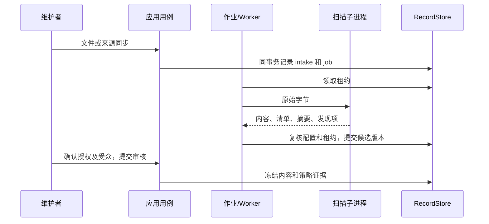

# 接收、发布与分发设计

## 接收

上传先解析请求、身份和幂等键，创建 intake 与作业。已有资产只有在当前正本来源为 upload 时才能接收手工上传；Git 资产必须通过来源同步接收，避免混淆来源证据。Git 来源只读取登记的精确目标：先固定提交和凭据修订，再按目标读取 Git 对象，路径必须为有效 UTF-8；不检出后执行仓库代码，不自动发现全部内容。

Skill 根文件是 SKILL.md；MCP 使用单一 server.json。ZIP 校验路径编码、重复/冲突、链接、尺寸和 CRC，脚本属性从实际内容推导。安装器保留的 .capability-hub-source 不允许出现在上传内容中。内容静态检查只产生 warning、info，风险提示由审核者确认，不执行脚本或递归展开嵌套归档。

规范化清单按 UTF-8 路径排序，记录 path、size、sha256、executable。规范 JSON 拒绝循环、稀疏数组、日期及非 JSON 值；内容摘要与归档摘要分别计算。

## 候选与审核

intake 从 received/fetching 经 scanning 进入 ready、failed 或 cancelled。版本保存不可变文件清单和对象引用；重新扫描产生独立扫描证据，不修改内容。上传重试只针对明确可重试的失败；Git 目标通过重新同步重试，不显示上传重试入口。扫描规则变化需重新扫描，来源同步也不复用旧规则证据。

分发受众可选公开、全部登录用户或指定团队与成员。场景分类可同时选择已有条目并提出新定义，两者合计最多 20 项。

申请冻结版本与扫描证据、来源修订与授权、受众、分类、已有场景 ID、新场景名称与说明、适用条件及发布基线，生成 policy_digest。批准时在发布事务中登记新场景，同名且说明一致时复用，定义冲突需重新提交。

批准要求：

1. 当前身份仍有对应审核范围，且不是提交者；通用提名还排除原来源共享者。
2. If-Match、策略摘要及内容/来源/资产上下文均匹配。
3. 当前规则扫描通过，内容对象仍可用。
4. 每个 warning 有非空接受理由；重复或未知 finding_id 被拒绝。

决定与发布指针在事务中提交，并追加审计。重复幂等请求复用同一结果。竞争决定只能成功一次；上下文改变后旧申请失效，不自动重放决定。

## 目录与分发

目录只缓存可分发记录，不缓存用户授权。查询在同一存储事务快照中计算可见集合及目录修订。游标签名绑定查询、身份、授权上下文和目录修订，15 分钟到期；条件变化需从第一页重新查询。

匿名只能访问 public 受众；organization 表示有效登录身份，group/principal 精确匹配。维护权限和审查权限不等于消费分发权限。审核者读取候选内容时必须覆盖该具体版本的申请。

历史版本还受当前发布受众约束。封禁、版本撤销、来源分发撤销或受众收窄后，旧公开地址和后续下载同样受限。内容读取、完整包交付和配置生成都重新校验。content.download 在归档内容读取成功后追加，记录交付尝试，不代表客户端下载已完成。

每位用户对同一资源计一票，升级沿用推荐，取消后保留审计。通用提名沿用当前内容、授权和受众，经独立审核后只改变分类。回退生成新的待审申请，保留当前适用条件和目标受众，不直接切换指针。来源迁移保留当前发布的分类、受众及适用条件；新路径检查采用与来源配置相同的大小写冲突和父子重叠规则。

## CLI 安装

下载后先校验清单结构、规范摘要、归档摘要、文件字节及脚本属性。dry-run 不创建目标，同时报告文件字节和执行权限差异。已有目录默认拒绝覆盖；显式 replace 保留旧目录备份。

同一目标用目录锁互斥，暂存文件使用私有权限。网络授权复核后再次比较目标字节与文件属性；目标发生变化即终止。父目录被替换或改成链接时，停止提交、恢复和基于原路径的清理；无法安全定位的暂存目录与锁保留，需人工检查原目录。提交使用同一文件系统 rename；失败时恢复旧目录，恢复位置被占用则保留备份并报告位置。异常退出可能遗留锁，需人工确认没有安装进程后处理。

## 静态检查的判定与边界

内容检查服务于提示和独立审核，不判断脚本语言是否适合执行，不以语言或扩展名建立准入白名单。SQL、Python、Groovy、未知语言、二进制资源均按字节接收和分发；平台不编译、不加载、不执行上传内容。现有 `executable` 推导仅决定安装权限及“含脚本”提示，不决定能否接收，也不保证识别所有脚本。

所有内容风险发现均为 warning 或 info，不再产生新的静态阻断结果。warning 必须由独立审核者逐项填写接受理由，未确认不能完成发布；提交者不能通过自审跳过确认。结构错误仍拒绝接收：损坏或加密 ZIP、链接/特殊条目、目录类型冲突、真实文件路径越界或碰撞、预算超限，以及无法建立资产元数据的无效根文件/Schema。

| 检查                                                                 | 处理与边界                                                                                                                                                                                                       |
| -------------------------------------------------------------------- | ---------------------------------------------------------------------------------------------------------------------------------------------------------------------------------------------------------------- |
| 凭据格式 `SECRET`、固定值 `SECRET_CANDIDATE`、私钥标记 `PRIVATE_KEY` | 仅提示，原文隐藏；不联网验证有效性。不按测试目录、`example`/`test` 前缀或特定模拟值豁免，也不声称覆盖全部供应商和编码方式。审核者核对用途；只有确认是真实凭据时才要求撤销或轮换。                                |
| MCP 声明秘密 `DECLARED_SECRET`                                       | 解析 JSON 后提示 `isSecret: true` 的固定 `value`/`default`，无论长度；变量引用、含已声明变量的模板或安装时输入无需提示。用 JSON Pointer 定位，行号为文件入口行，不回显值。协议前缀、模拟值与真实值由审核者判断。 |
| 双向文本 `BIDI` / `BIDI_PATH`                                        | 源码、文档和文件名统一提示核对显示顺序，不按语言分级。转义字符说明不等于实际控制字符。                                                                                                                           |
| 下载执行 `DOWNLOAD_EXECUTE`                                          | 提示下载管道、续行及常见 shell 进程替换。不把普通分号后的不相关 shell 直接当作执行下载内容；不做完整语言或数据流分析。                                                                                           |
| Markdown 引用                                                        | 用语法树提示真实链接、图片和定义的缺失、错误编码或包外目标，忽略代码示例。支持目录、编码空格、查询和协议相对外链；不联网检查外链或验证锚点。包外链接只提示，不访问目标。                                         |
| Git LFS                                                              | 完整指针格式提示确认是否有意分发指针；普通说明中提到 LFS 协议不误报。                                                                                                                                            |
| 二进制及内嵌归档                                                     | 非 UTF-8 文本和内嵌归档提示确认，保持原字节，不按文件后缀拒绝，也不递归扫描归档。合法 UTF-8 BOM 可解析，分发字节不改写。                                                                                         |
| 提示数量过多                                                         | 最多展开 1000 条，另加一条 `SCAN_TRUNCATED` 告知后续未检查，要求完整人工审查；不会因提示数量阻断接收。                                                                                                           |

ZIP 最多 6500 个条目（含目录），原始文件最多 500，单文件最多 10 MiB，总内容最多 100 MiB；先检查预算再忽略打包元数据。同一文件、行号的多项发现仍有独立且稳定的 ID。

规则版本由 `contentScanRuleset` 统一管理。修改识别、严重度、文件解析或发现项语义必须更新规则版本，并验证确认流程与旧证据失效。旧扫描证据不能用于新规则下的发布审核或来源同步复用；原始内容和不可变历史证据不改写，不增加旧内容转换或兼容路径。

检查完成不等于内容安全、脚本可运行或凭据不存在。动态构造、编码、未知格式与嵌套资源仍需人工审查；运行失败、超时等没有检查结论的情况也不会伪造为检查通过。

凭据格式的维护可对照 [Gitleaks 官方规则](https://github.com/gitleaks/gitleaks/blob/master/config/gitleaks.toml)，但本项目未集成 Gitleaks 引擎，也不宣称具备其完整检测覆盖。格式规则只增加提示覆盖，不应变成新的准入限制。
